# Kenya Household Cash-Flow Pipeline

An end-to-end data engineering pipeline that turns a raw file of about 484,000 household transactions from Kenya into clean, tested tables and a dashboard. It runs weekly on Apache Airflow.

Built by Millicent (mgm) as the capstone project for the Data Ladder data engineering track.

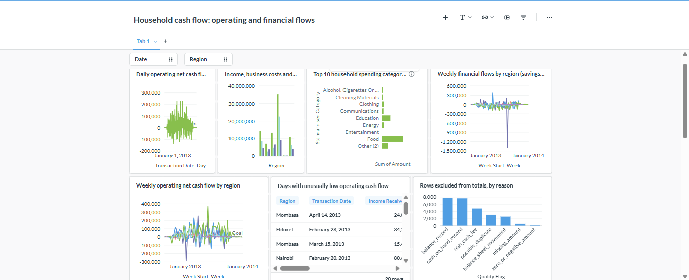

## The problem

Households in Kenya can face sudden drops in cash flow from shocks such as illness, job loss, school fees or a failed harvest. A financial inclusion analyst or NGO programme manager wants to see **when and where households run short of cash**, so that financial products and support programmes can be designed more responsibly.

This pipeline answers that by producing:
- daily and weekly cash inflows and outflows for each of the 5 regions
- spending by category
- a list of days with unusually low operating cash flow
- a clear count of the rows left out of the totals, and why

## The data

The Kenya Financial Diaries household transactions file, provided for the capstone.

| | |
|---|---|
| Rows and columns | 483,949 rows x 58 columns |
| Households | 298 |
| Regions | Vihiga (63 households), Makueni (61), Eldoret (59), Mombasa (59), Nairobi (53), plus 3 households whose region is not confirmed |
| Transaction dates | 1 Aug 2012 to 31 Dec 2013 |
| Amounts | Kenyan shillings (KES) |

## Architecture

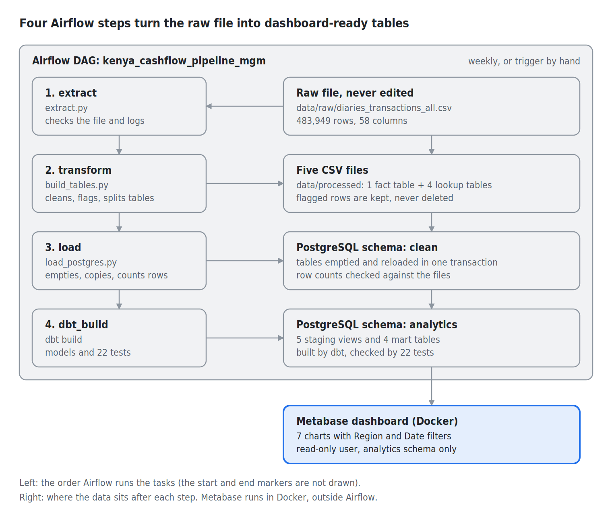

An Airflow DAG called `kenya_cashflow_pipeline_mgm` runs four tasks in order, every week or on demand:

1. **extract** (`extract.py`): checks the raw file exists, is not empty, can be read, and has the columns the pipeline needs. Warns if the row or column count looks wrong. Logs everything to `logs/pipeline.log`.
2. **transform** (`build_tables.py`, using `clean_transform.py`): cleans dates and text, adds the new columns and quality flags, splits the data into one fact table and four lookup tables, and saves them as five CSV files.
3. **load** (`load_postgres.py`): empties the five tables, copies the CSV files into PostgreSQL in a single transaction (all or nothing), then checks that every table's row count matches its file.
4. **dbt_build** (`cashflow_dbt/`): builds the dashboard tables and runs the data tests.

Metabase runs in Docker, outside Airflow, and reads only the `analytics` schema through a read-only user.

Every step can be re-run safely, so failed tasks retry automatically. The one exception is extract, which does not retry because a missing or broken file will not fix itself in two minutes.

## Data model

A star schema in the `clean` schema of PostgreSQL.

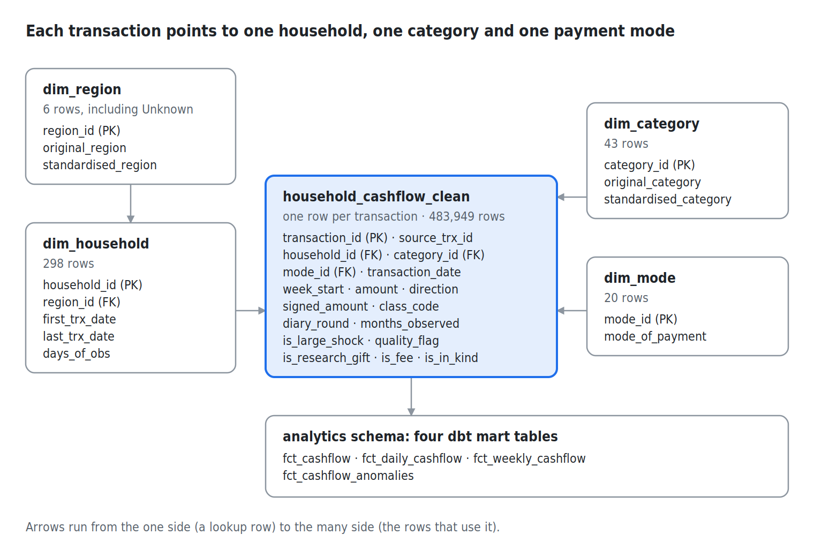

| Table | Rows | What it holds |
|---|---|---|
| `household_cashflow_clean` (fact) | 483,949 | One row per transaction: date, week, amount, direction, signed amount, class, quality flag |
| `dim_household` | 298 | One row per household, its region, first and last diary date |
| `dim_region` | 6 | The 5 regions, plus `Unknown` for the 3 unmapped households |
| `dim_category` | 43 | Spending and income categories, original and standardised |
| `dim_mode` | 20 | Payment method, including in-kind payments |

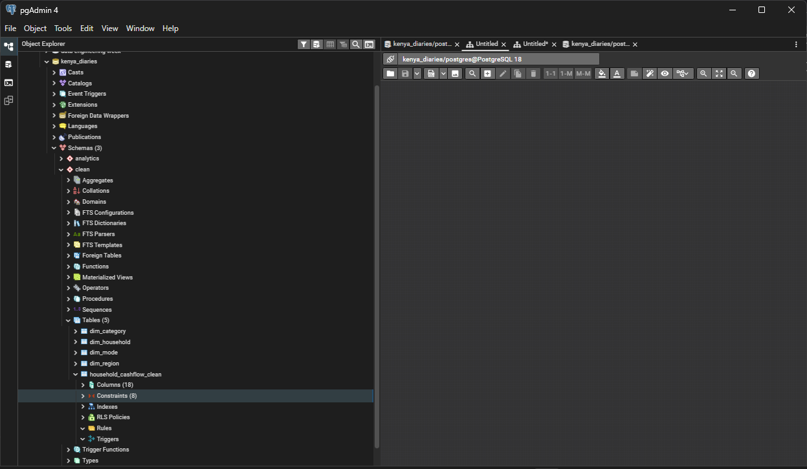

dbt then builds the `analytics` schema on top: 5 staging views and 4 mart tables (`fct_cashflow`, `fct_daily_cashflow`, `fct_weekly_cashflow`, `fct_cashflow_anomalies`).

## Data quality decisions

The raw file needed real cleaning. The main decisions:

- **Dates were stored as text** (like `01Aug2012`). They are converted to real dates, and the conversion reports how many values fail. All 7 date columns converted with 0 failures.
- **The file's own transaction ID is not unique**, because its long numbers were rounded. The pipeline creates its own `transaction_id` and keeps the original as `source_trx_id`.
- **Text is tidied into new `_std` columns**, and the originals are left untouched.
- **Region comes from the household ID.** The first four letters are a site code (for example `KELD` for Eldoret).
- **Nothing is deleted.** Rows with a problem get a `quality_flag` and stay in the database, so the choice of what to exclude is visible and can be changed. The first problem found wins:

| Flag | Rows |
|---|---|
| (no problem) | 453,399 |
| `balance_record` | 7,666 |
| `cash_on_hand_record` | 7,599 |
| `non_cash_fee` | 4,757 |
| `large_shock` (above the 99th percentile for its direction) | 4,451 |
| `possible_duplicate` | 3,029 |
| `balance_sheet_movement` | 2,514 |
| `missing_amount` | 518 |
| `zero_or_negative_amount` | 16 |

- **Operating flows and financial flows are kept separate.** Income and everyday spending (operating) are not mixed with savings and loans (financial), because a deposit into savings is not the same as money lost. Following the dataset's own guide, income from the first two diary rounds, from a household's first month, and research-firm gifts is left out of the totals. On the rows that count, operating net cash flow is 8,019,145 KES and financial net flow is -6,606,266 KES.

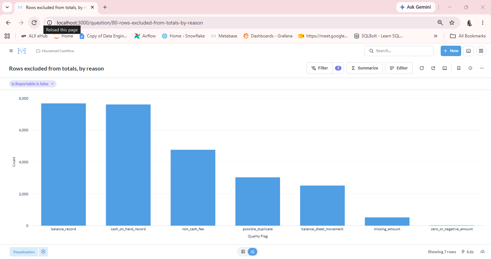

## Testing

- **Pipeline checks** in Python: the file exists and has the expected columns, the primary key is unique, no household is missing from the household table, no category or mode IDs are missing, and loaded row counts match the files.
- **Database rules** in `sql/create_tables.sql`: primary and foreign keys, allowed values for direction, class and quality flag, and a check that an inflow can never have a negative signed amount.
- **22 dbt data tests**, covering things like: every household has a region, the daily summary matches the transactions, and no non-cash flows slip into the totals. The last full dbt build finished with 30 passed, 1 warning and 0 errors. The warning is the "every household has a region" test, which finds the 3 households (site code `KZIM`) whose region is not confirmed.

## Dashboard

A Metabase dashboard with 7 charts and Region and Date filters.

| | |
|---|---|
| 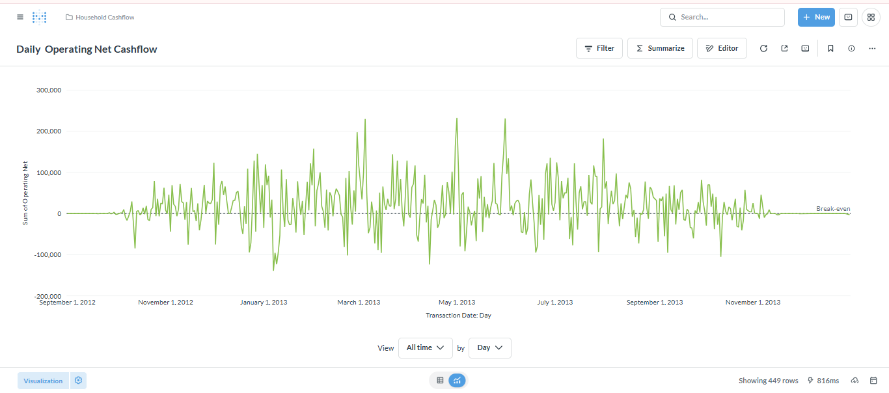 | 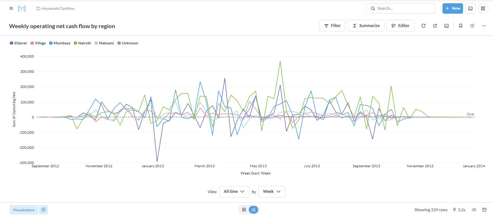 |
| Daily operating net cash flow | Weekly operating net cash flow by region |
| 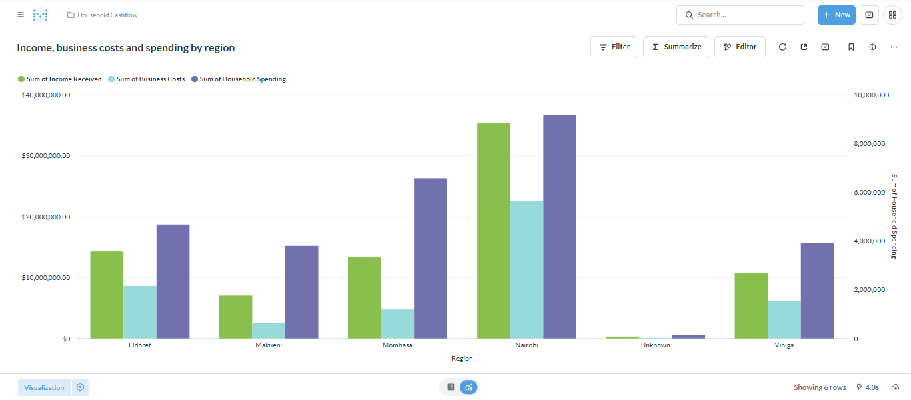 | 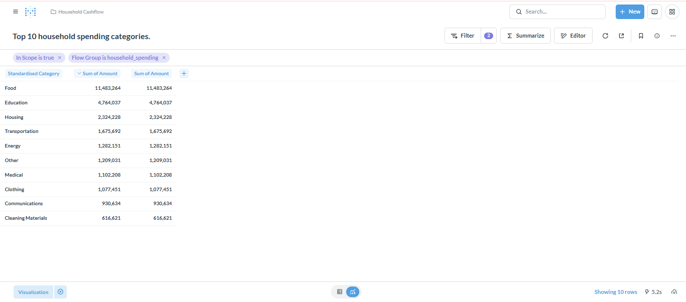 |
| Income, business costs and spending by region | Top 10 household spending categories |
| 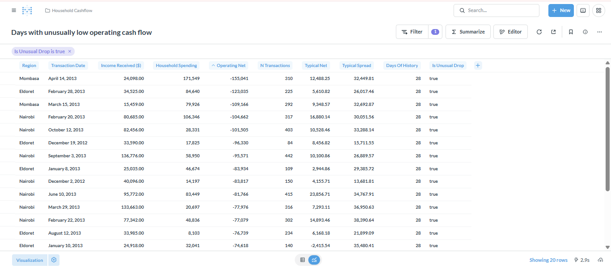 | 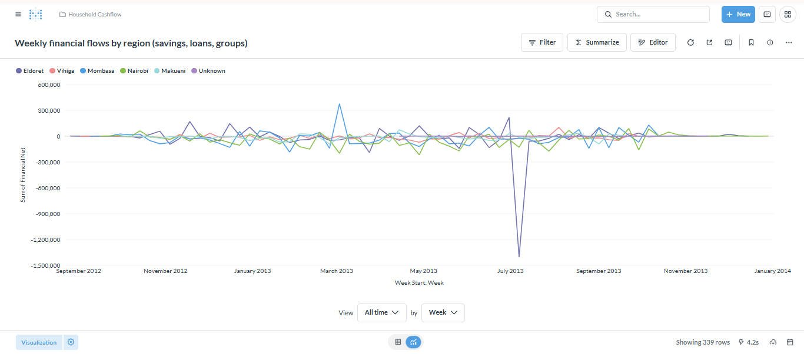 |
| Days with unusually low operating cash flow | Weekly financial flows (savings and loans) by region |

The Airflow run, all four tasks succeeding:

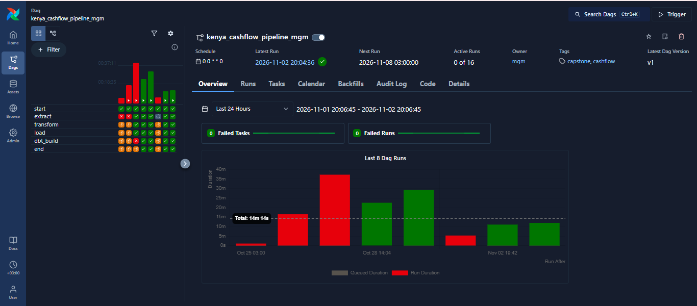

## Tech stack

- **Python** (pandas, NumPy, psycopg2, python-dotenv) for extract, transform and load
- **PostgreSQL 18** for storage
- **dbt** (Postgres adapter) for modelling and testing
- **Apache Airflow** for orchestration, running in WSL
- **Metabase** in Docker for the dashboard

## Project structure

```
.
├── extract.py                        # step 1: read and check the raw file
├── clean_transform.py                # cleaning and column-building functions
├── build_tables.py                   # step 2: build the five tables, save as CSV
├── load_postgres.py                  # step 3: load into PostgreSQL and verify
├── kenya_cashflow_pipeline_mgm.py    # the Airflow DAG
├── explore.py                        # data profiling
├── test_connection.py                # checks the database connection
├── run_sql.py                        # runs a .sql file against the database
├── try_extract.py                    # early extract experiment
├── sql/
│   └── create_tables.sql             # schema, keys, checks, indexes
├── cashflow_dbt/                     # dbt project
│   ├── models/staging/               # 5 staging views
│   ├── models/marts/                 # 4 mart tables
│   └── tests/                        # custom data tests
└── docs/                             # diagrams and screenshots
```

## How to run it

You need Python 3, PostgreSQL, and the raw CSV.

1. Install the libraries:
   ```
   python -m pip install pandas numpy psycopg2-binary python-dotenv dbt-postgres
   ```
2. Create a PostgreSQL database, then create a `.env` file in the project folder with your own connection details (this file is ignored by Git and is never uploaded):
   ```
   PGHOST=localhost
   PGPORT=5432
   PGDATABASE=your_database
   PGUSER=your_user
   PGPASSWORD=your_password
   ```
3. Check the connection, then create the tables:
   ```
   python test_connection.py
   python run_sql.py sql/create_tables.sql
   ```
4. Put the raw file at `data/raw/diaries_transactions_all.csv`, then run the steps in order:
   ```
   python extract.py
   python build_tables.py
   python load_postgres.py
   ```
5. Set up a dbt profile for the same database (in `~/.dbt/profiles.yml`), then:
   ```
   cd cashflow_dbt
   dbt build
   ```
6. To run everything on a weekly schedule, point Airflow at `kenya_cashflow_pipeline_mgm.py`.

## Known limitations

- The three `KZIM` households have no confirmed region, so they show as `Unknown`.
- The Airflow DAG has my own computer's folder paths written into it. Change `PROJECT` and `PYTHON` at the top of the file before using it elsewhere.
- There is no `requirements.txt` yet.
- The raw data is not in the repo, so the pipeline cannot run until you add it.

## Author

Millicent (mgm), Nairobi, Kenya. Economics and statistics graduate (Maasai Mara University) moving into data science and data engineering.

GitHub: [millicent-mgm](https://github.com/millicent-mgm)
